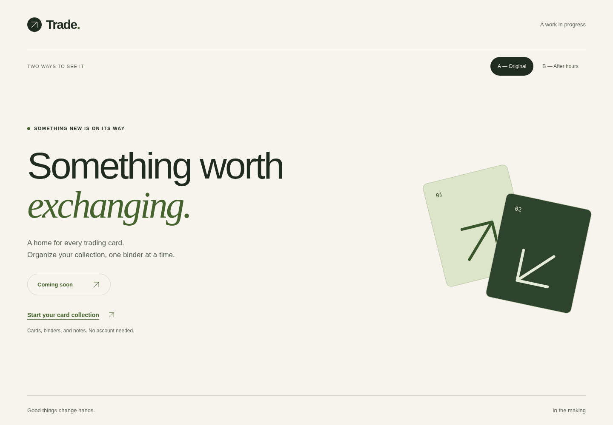
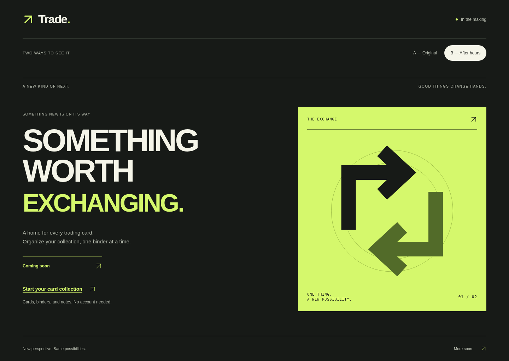
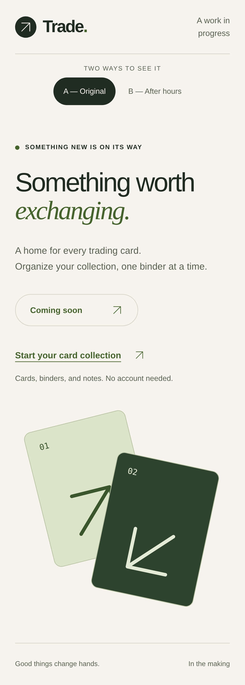
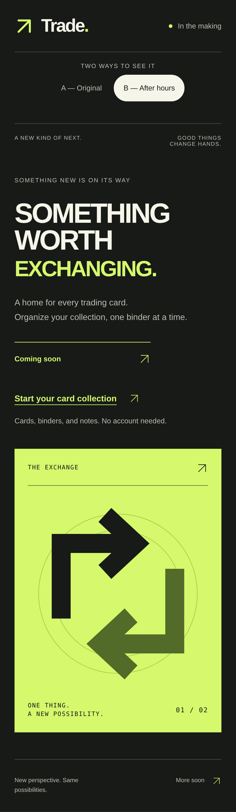
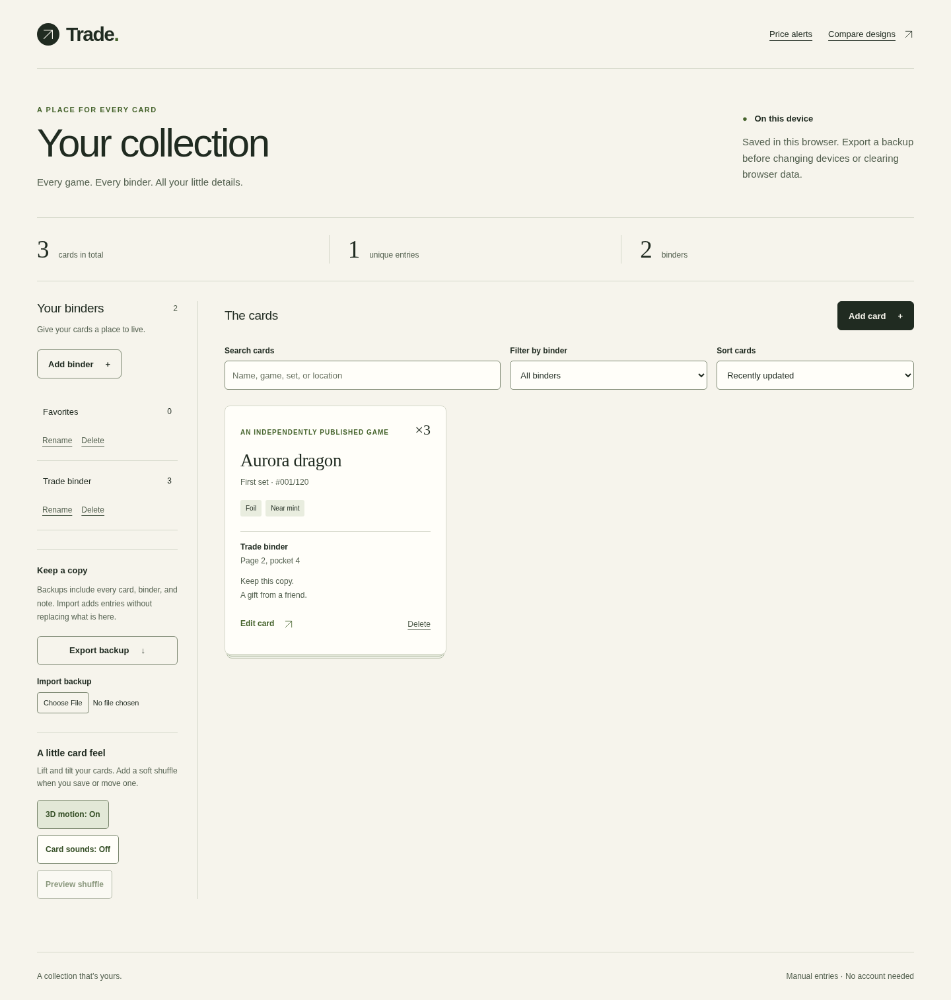
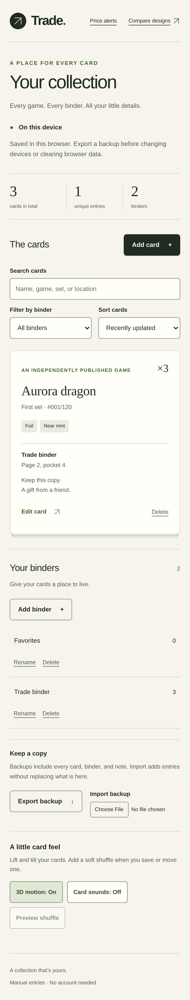
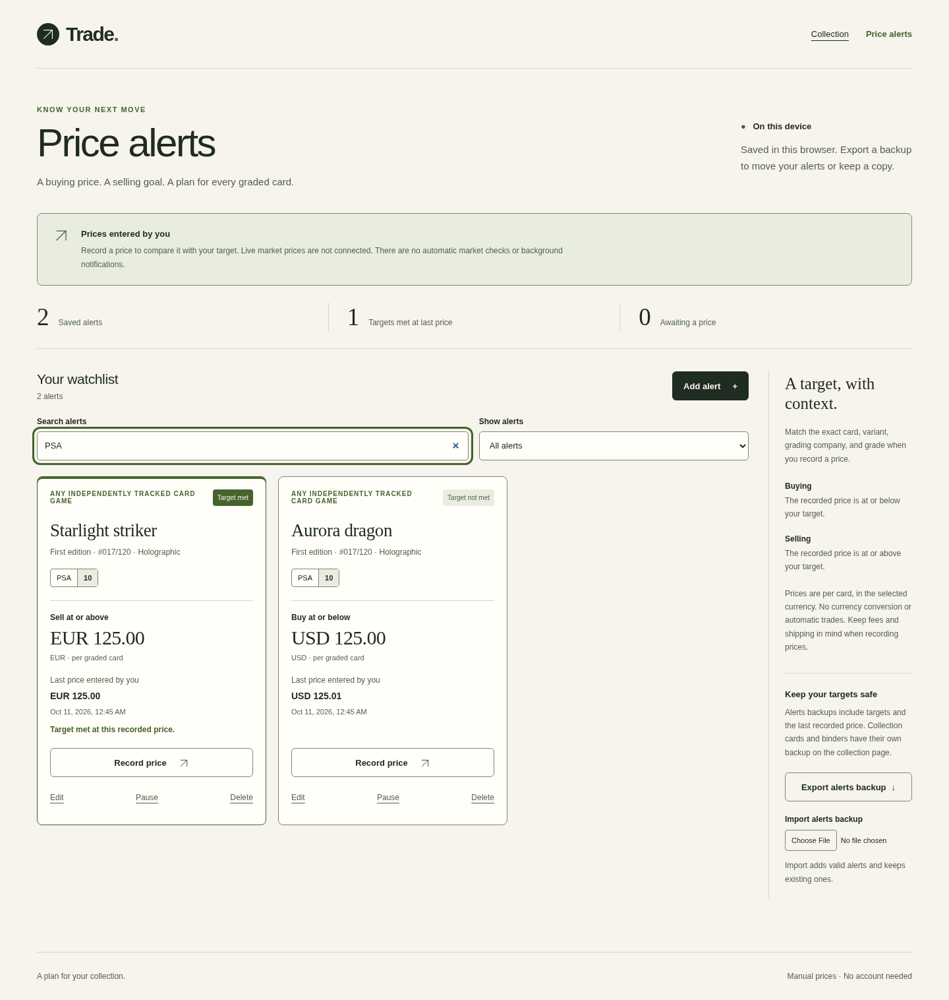
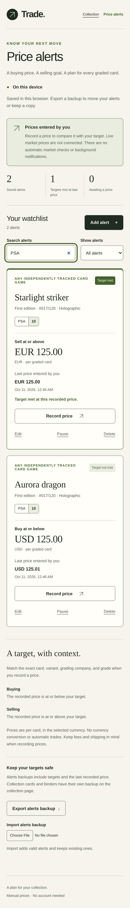

# Two ways to see it

The same prelaunch message, in two visual directions. These are screenshots of the
implemented pages, not mockups. Open either image for the full-size preview.

| A — Original | B — After hours |
| --- | --- |
| Cream, forest green, soft shapes and a quieter pace. | Charcoal, citron, oversized type and geometric exchange artwork. |
| Route: `/` | Route: `/alternate` |
|  |  |
|  |  |

Captured from the production build in Chromium at 1440 × 1000 and 390 × 844
(full-page captures). Both pages have A/B navigation, visible keyboard focus and
the same link to the on-device collection. The working name is still configured in
`src/lib/site.ts`. Vercel is selected; a public deployment is pending hosting access.

## The collection

Both designs open the same `/portfolio` workflow. These screenshots use fictional test
entries to show card details, quantities, binder assignment and page/pocket notes. New
collections start empty; these example cards are not added to anyone’s collection.

| Desktop collection | Mobile collection |
| --- | --- |
|  |  |

Cards are saved in the current browser. JSON export/import moves them between devices
or domains; accounts and automatic synchronization are not connected.

## Card movement and graded-card targets

Collection cards now tilt and lift in 3D with pointer, touch and keyboard interaction.
The sidebar offers independent motion and sound controls. Sound is off by default;
Preview shuffle plays the synthesized card rustle after enabling it. Reduced-motion
preferences keep cards still.

The `/alerts` page stores graded-card buying and selling targets. These production
screenshots use fictional cards and manually entered example prices, not market data.
A new watchlist starts empty. Target status refers to the last entered price and its
recorded timestamp; live pricing and background notifications are not connected.

| Desktop price alerts | Mobile price alerts |
| --- | --- |
|  |  |

Export alert backups separately from collection backups when moving devices or domains.
